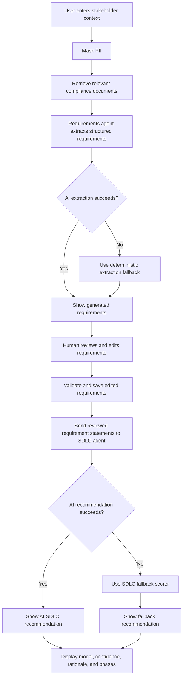
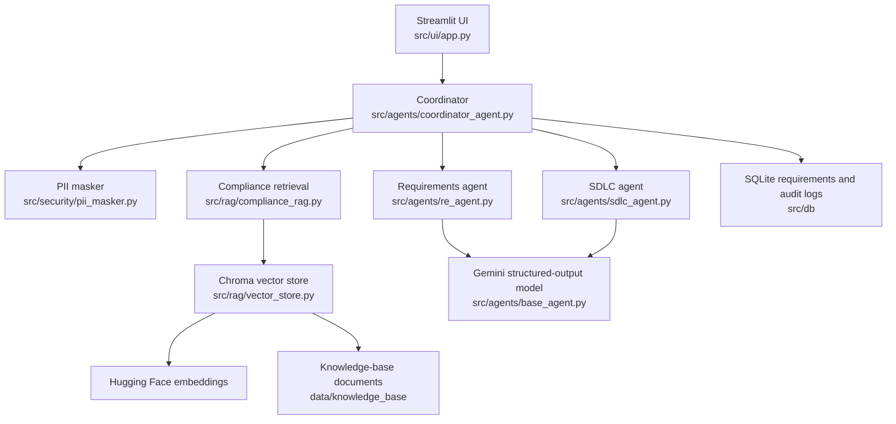

# FinTech Agentic AI

FinTech Agentic AI is a requirements-engineering platform for financial software projects. It converts unstructured stakeholder input into structured requirements, retrieves relevant compliance guidance, supports human review, persists an auditable record, and recommends an appropriate Software Development Life Cycle (SDLC) model.

The application uses a Streamlit interface, Gemini structured-output agents, a local Chroma vector database, Hugging Face embeddings, Pydantic validation, and SQLite persistence.

## Why this project exists

Financial software requirements often arrive as interview notes, customer emails, or informal conversations. Those inputs may contain ambiguity, privacy-sensitive data, security constraints, and regulatory obligations. This project provides a repeatable workflow for turning that input into a reviewed and traceable engineering decision.

## Main capabilities

- Masks common PII before it reaches retrieval or AI processing.
- Retrieves relevant compliance content from a local vector database.
- Extracts structured requirements using Gemini.
- Classifies requirements and identifies ambiguity, risk, priority, and compliance mapping.
- Allows a stakeholder or analyst to edit the generated requirements.
- Sends the reviewed requirements to the SDLC recommendation agent.
- Recommends Waterfall, V-Shaped, Incremental, Rapid Application Development, Prototyping, Spiral, or Agile.
- Stores requirements and audit history in SQLite.
- Uses deterministic fallback behavior when an AI call fails.
- Labels SDLC results as AI-generated or fallback-generated.


## Detailed user workflow



## Architecture



## End-to-end process

### 1. Application startup

`main.py` launches Streamlit using `src/ui/app.py`. The UI initializes the SQLite schema through `init_db()`. Configuration is loaded by `src/config.py`, including the Gemini API key, Gemini model, embedding model, and data directories.

### 2. Security preprocessing

`src/agents/coordinator_agent.py` calls `sanitize_input()` before any retrieval or AI call. `PIIMasker` detects and replaces common sensitive values:

- Credit-card numbers
- Social-security numbers
- Email addresses
- Account numbers

### 3. Compliance retrieval

`retrieve_compliance_guidelines()` searches the persistent Chroma collection. Documents are loaded and chunked by `src/rag/document_loader.py`, embedded by `src/rag/vector_store.py`, and queried through `src/rag/compliance_rag.py`.

The included knowledge-base references are:

- `data/knowledge_base/regulations/pci_dss_v4_0_1_reference.txt`
- `data/knowledge_base/regulations/gdpr_reference.txt`
- `data/knowledge_base/regulations/sox_section_404_reference.txt`
- `data/knowledge_base/policies/fintech_security_baseline.txt`

These are concise educational summaries used for retrieval and SDLC classification. They are not substitutes for the official standards, legal advice, or a formal compliance assessment.

### 4. Requirements extraction

`process_requirements()` sends the sanitized input and retrieved compliance context to Gemini. The response is validated through `AnalyzedRequirement` and `REAgentOutput`. The coordinator converts the result into records containing an ID, domain, source, priority, compliance mapping, risk level, confidence score, and review status.

If the AI call fails, the requirements agent uses a deterministic fallback that splits stakeholder text into sentences and infers basic categories, priority, compliance, and risk fields.

### 5. Human review

The UI displays requirements before requesting an SDLC recommendation. Users can edit the statement, category, priority, and risk level. The reviewed values are validated and persisted before the SDLC agent runs.

### 6. SDLC recommendation

`recommend_from_requirements()` sends the final reviewed requirement statements and retrieved context to `recommend_sdlc()`. The response contains the model, confidence, rationale, key phases, and whether the selection came from AI or fallback.

### 7. Persistence and audit

`RequirementRepository` saves requirements in SQLite and creates audit records. `AuditRepository` supports retrieving requirement history and recording status changes.

## Project structure

```text
Fintech_AgenticAI/
├── main.py                         # Application launcher
├── requirements.txt                # Python dependencies
├── .env                            # Local secrets and model configuration
├── data/
│   ├── knowledge_base/             # Compliance documents
│   ├── vector_db/                  # Persistent Chroma database
│   └── requirements.db             # SQLite requirements and audit logs
├── src/
│   ├── agents/
│   │   ├── base_agent.py           # Gemini initialization and safe invocation
│   │   ├── coordinator_agent.py    # Workflow orchestration
│   │   ├── re_agent.py             # Requirements extraction
│   │   └── sdlc_agent.py           # SDLC recommendation
│   ├── db/                         # SQLite connection, models, repositories
│   ├── rag/                        # Document loading, embeddings, retrieval
│   ├── security/                   # PII, prompt guard, and role checks
│   └── ui/app.py                  # Streamlit interface
└── tests/                          # Unit and integration-style tests
```

## Configuration

Create a `.env` file in the project root. Do not commit real secrets.

```env
GEMINI_API_KEY=your-gemini-api-key
GEMINI_MODEL=model_you_are_using
EMBEDDING_MODEL=embedding_model_you_are_using
ENVIRONMENT=development
```

| Variable | Purpose |
|---|---|
| `GEMINI_API_KEY` | Authentication for Gemini API calls |
| `GEMINI_MODEL` | Gemini model used by the agents |
| `EMBEDDING_MODEL` | Local Hugging Face embedding model |
| `ENVIRONMENT` | Application environment label |

## Installation and running

```bash
pip install -r requirements.txt
streamlit run src/ui/app.py
```

Alternatively:

```bash
python main.py
```

## Testing

```bash
python -m unittest discover -s tests -v
```

The tests cover PII masking, prompt-injection detection, role checks, document loading, vector-store construction, compliance retrieval, database persistence, audit logs, structured agent responses, and fallback behavior.

## Important implementation boundary

The PII masker is connected directly to the coordinator workflow. The prompt-injection detector and role-based authorization modules are implemented and tested, but the current coordinator path does not yet invoke those two modules. Integrating them before the AI call is an important production-hardening step.

## Future improvements

- Connect prompt-injection detection and role authorization directly to the coordinator.
- Add authentication and user-specific sessions.
- Add a compliance-document administration screen.
- Store model latency, failure reasons, and token usage in audit telemetry.
- Add traceability from each requirement to a source document and control ID.
- Add automated tests for the complete interactive Streamlit workflow.

## Academic use

This repository is an academic and prototype project demonstrating agentic AI, retrieval-augmented generation, human-in-the-loop requirements engineering, and audit-friendly persistence in a fintech context.
